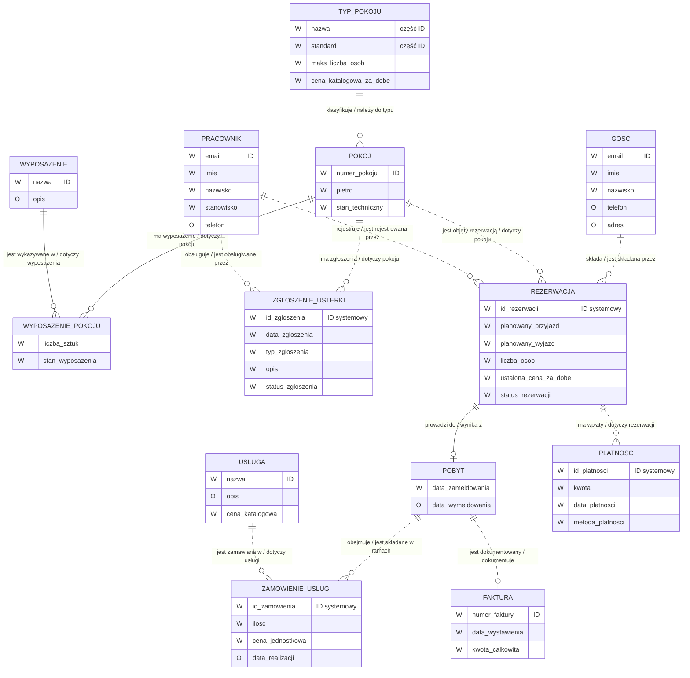

sqlprojekt
Diagram encji i związków (ER) – system obsługi hotelu
Model koncepcyjny obejmuje 13 encji i 13 związków.

Oznaczenia
`W` oznacza atrybut wymagany, a `O` atrybut opcjonalny. `ID` wskazuje identyfikator. Dwa atrybuty oznaczone jako `część ID` tworzą wspólnie jeden identyfikator.
Linia ciągła oznacza związek identyfikujący. Pobyt jest identyfikowany przez związek z rezerwacją, a wyposażenie pokoju przez parę związków z pokojem i wyposażeniem.
Etykieta każdego związku zawiera dwie nazwy oddzielone ukośnikiem. Pierwszą czyta się od encji wymienionej jako pierwsza w kodzie Mermaid, a drugą od encji po przeciwnej stronie związku.
Założenia modelu
E-mail jest wymagany i unikatowy osobno wśród gości i pracowników. Nazwy usług i wyposażenia są unikatowe w swoich katalogach. Typ pokoju identyfikuje para nazwa + standard.
Rezerwacja dotyczy jednego pokoju i może prowadzić do najwyżej jednego pobytu. Pobyt może mieć najwyżej jedną fakturę.
Pracownik rejestruje każdą rezerwację. Zgłoszenie usterki ma przypisanego pracownika od chwili rejestracji.
Zaliczka może wpłynąć przed zameldowaniem. Usługi zamawia się podczas pobytu. Daty wymeldowania i realizacji usługi mogą początkowo być puste.
Aktywne rezerwacje tego samego pokoju nie mogą się nakładać. Kolejny gość może przyjechać w dniu wyjazdu poprzedniego. Stawka za dobę i cena jednostkowa usługi są zapisywane w chwili rezerwacji lub zamówienia.
