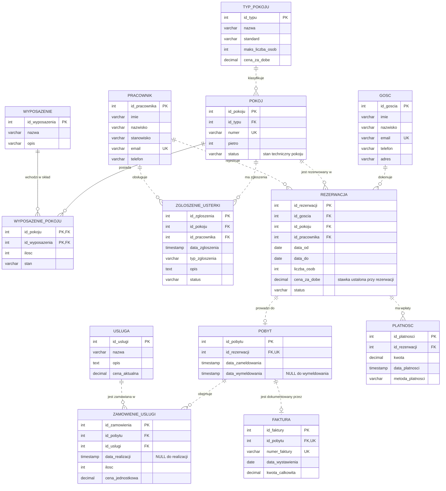

sqlprojekt
Diagram Encji i Związków (ERD) - System Obsługi Hotelu

Założenia modelu
Rezerwacja dotyczy jednego pokoju i jednego gościa rezerwującego. Może prowadzić do jednego pobytu, a pobyt może mieć jedną fakturę.
Płatności są przypisane do rezerwacji, dzięki czemu można zapisać zaliczkę przed zameldowaniem. Zamówienia usług składa się podczas pobytu i przypisuje do tego pobytu.
Każdą rezerwację rejestruje pracownik. Każde zgłoszenie usterki jest przypisane do pracownika.
Jeden wiersz `WYPOSAZENIE_POKOJU` opisuje łączną liczbę sztuk danego rodzaju wyposażenia w pokoju. Para `(id_pokoju, id_wyposazenia)` tworzy jeden klucz główny.
Reguły do wymuszenia w bazie SQL
Każdy `FK` widoczny w diagramie jest obowiązkowy (`NOT NULL`). `POBYT.id_rezerwacji` i `FAKTURA.id_pobytu` wymagają także `UNIQUE`.
`data_od < data_do`. Dwie aktywne rezerwacje jednego pokoju nie mogą się nakładać, również przy równoczesnym zapisie. Termin obejmuje dzień przyjazdu i kończy się przed dniem wyjazdu (`[data_od, data_do)`). Dostępność zależy od terminu oraz stanu technicznego pokoju.
`liczba_osob` musi wynosić co najmniej 1 i mieścić się w limicie typu pokoju. Ilości wyposażenia i zamawianych usług muszą być dodatnie.
Gdy podano `data_wymeldowania`, musi ona być późniejsza niż `data_zameldowania`. Stawkę za dobę i cenę jednostkową usługi zapisuje się odpowiednio w chwili rezerwacji i zamówienia.
